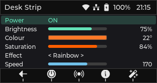
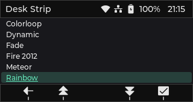
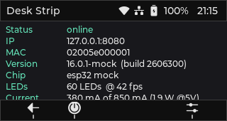

# ZeroLED for CardputerZero

Find and control the [WLED](https://kno.wled.ge) lights on your network from the
CardputerZero keyboard. Built on the
[CardputerZero Template](https://github.com/CardputerZero/Template) (C++17, LVGL 9.5, MVVM).

<p>
  
  
  
</p>

## Features

- **Automatic discovery** of WLED controllers, using three sources:
  - mDNS `_wled._tcp`, with no avahi dependency
  - WLED's UDP node broadcasts on port 65506
  - each controller's `/json/nodes` peer list
- **Manual add by IP** (optionally `ip:port`) for networks that block multicast. Added
  addresses are saved to the config file.
- **Per-device control**: power, brightness, colour (hue and saturation), effect (step through
  them or pick from a sorted list), effect speed and intensity.
- **UDP sync**: turn send and receive on or off separately, or both at once. Works with
  WLED ≤ 0.14 (writable `recv` flag) and with newer firmware such as 0.15 and 16.x, where
  receive is set by the `rgrp` group mask.
- **Info page** with firmware version and build, chip, LED count and FPS, current draw
  against the limiter, Wi-Fi signal/RSSI/channel, uptime, free heap, sync groups,
  live/realtime source, storage and client counts.
- **No UI freezes**: all networking runs on worker threads. Requests to one controller run in
  order, while different controllers are handled in parallel, so an offline device can't stall
  the others. Holding a key coalesces commands, so only the latest value is sent.

## Keys

Keys 4–8 sit directly under the screen and match the five icons in the bottom bar. Following
the CardputerZero key guidelines, **F/Z/X/C work as arrow keys** outside text entry, so you
don't need to hold `fn`. Holding an arrow key repeats it. `fn+H` (or `H`) shows help for the
current page.

| Page | Keys |
| --- | --- |
| Devices | F/X select · ENTER/8 open · SPACE/5 power · 6 rescan · 7 add by IP · hold ESC/4 exit |
| Control | F/X row · Z/C adjust · ENTER toggle or open effect list · 5 power · 6 sync on/off · 7 info · 8 effects · ESC back |
| Effects | F/X move · Z/C or 5/7 page · ENTER/8 apply · ESC back |
| Info | F/X scroll · SPACE/5 power · 8 controls · ESC back |
| Add by IP | digits and `.` · DEL erase · ENTER add · ESC cancel |

## Layout

```text
src/
├── model/           plain data: WLED state/info types, DeviceStore, HSV colour maths
├── platform/net/    sockets, worker threads, no LVGL
│   ├── http_client  minimal HTTP/1.1 client (Content-Length + chunked)
│   ├── mdns         DNS-SD PTR browse + response parser
│   ├── wled_api     /json/si, /json/eff, /json/nodes parsing, /json/state patch builders
│   └── wled_service discovery thread, UDP 65506 listener, 3-worker request pool
├── viewmodel/       BaseViewModel: polling schedule, optimistic updates, actions
├── view/screens/    devices, control, effects, info, add-device pages
└── app/             lifecycle, screen routing, key handling, config persistence
tests/unit_tests.cpp parsers, patches, colour, store (no network needed)
tools/wled_probe.cpp CLI using the same service: discover | info <ip> | set <ip> <json>
tools/mock_wled.py   fake WLED for testing writes without real lights
```

The UI applies a change straight away (optimistic update) and sends the command. Each local
change bumps a per-device *generation*, and a poll reply that left the device before the latest
command is ignored, so the screen never jumps back to stale values. The open device is polled
every second, the list every 3 s, and offline devices every 15 s.

## Build and run on the desktop simulator

Install the dependencies listed in the template's instructions (CMake ≥ 3.31, Ninja, SDL2,
FreeType, libpng, libjpeg, fmt). CMake also downloads LVGL and nlohmann/json.

```shell
cmake --preset darwin-arm64            # or linux-x86-64, etc.
cmake --build --preset darwin-arm64-dbg
ctest --test-dir build/darwin-arm64 -C Debug
./build/darwin-arm64/Debug/zeroled
```

The simulator discovers real controllers on your LAN. To test writes without touching real
lights:

```shell
python3 tools/mock_wled.py --name "Desk Strip" --port 8080 &
printf '[wled]\ndevices=127.0.0.1:8080\n' > /tmp/wled-test.conf
ZEROLED_CONFIG=/tmp/wled-test.conf ./build/darwin-arm64/Debug/zeroled
```

Desktop-only environment variables:

| Variable | Purpose |
| --- | --- |
| `ZEROLED_CONFIG` | config file to load/save instead of `config/zeroled.conf` |
| `ZEROLED_SCREENSHOT_DIR` | where screenshots go (default `~/Pictures/Screenshots`) |
| `ZEROLED_SCRIPT` | scripted run, e.g. `wait:5000,expect:Desk Strip,enter,shot,quit` (keys: `up down left right enter esc space bksp help`, single characters, `wait:<ms>`, `shot`, `expect:<name>`, `quit`) |

## Device build and packaging

The toolchain lives in a Docker image (`docker/Dockerfile`, Debian trixie to match the BSP's
GCC 14/glibc). The only host requirement is Docker:

```shell
tools/docker-build.sh                          # -> dist/zeroled_0.1.1_1_arm64.deb
tools/docker-build.sh bash                     # shell with cmake, the cross and desktop toolchains
tools/docker-build.sh cmake -DPACKAGE_FILE=dist/zeroled_0.1.1_1_arm64.deb \
    -P .agents/skills/cardputerzero-package-release/scripts/validate_app_builder.cmake
REMOTE_USER=<user> REMOTE_HOST=<device-ip> ./deploy.sh   # uses Docker if cmake isn't installed
```

The first configure downloads the BSP sysroot (~435 MB) into `.cache/`. Without Docker, install
`crossbuild-essential-arm64` and CMake >= 3.31 and run `cmake --workflow --preset cp0-cross-package`.

The package installs `/usr/bin/zeroled`, `/etc/zeroled.conf` and an APPLaunch entry.
Per-user settings and devices added by IP go to `~/.config/zeroled/zeroled.conf`.
No systemd service is installed.

## Before publishing to the CardputerZero Store

- Store metadata (`app-builder.json`) and the package maintainer are filled in; the licence is MIT.
- Push the source to https://github.com/matqua/zeroled (the `source_repo` in the manifest).
- Replace the screenshots with ones taken on the device (`fn+J`) if you like.
- Record a demo video on a real device for the first-submission review.
- Run `cmake -P .agents/skills/cardputerzero-package-release/scripts/validate_app_builder.cmake`.
